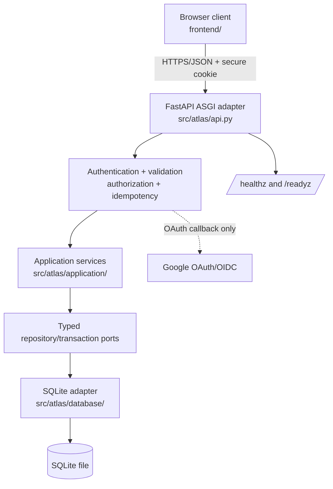
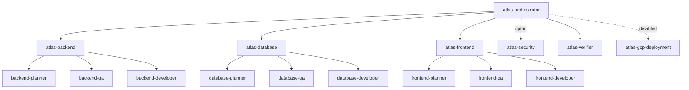
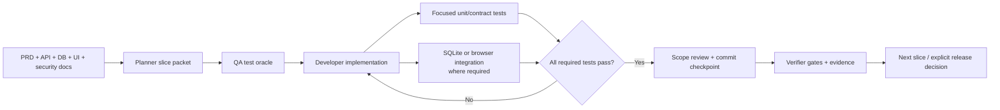

# Atlas Pools Server

Atlas is a Python ASGI application for private pool groups. Authenticated users
belong to groups, administrators manage membership and pool lifecycle, members
answer an open pool once, and members see aggregate results after closure. The
repository is specification-led, but it also contains a working local
FastAPI/SQLite implementation and browser client. It is not a deployment
instruction: cloud deployment is disabled unless explicitly enabled and gated.

## Status and source of truth

The authoritative product and API behavior is in `docs/`, especially:

- [`docs/PRD.md`](docs/PRD.md): product actors, lifecycle invariants, privacy,
  and completion criteria.
- [`docs/API.md`](docs/API.md): `/v1` REST paths, response shapes, errors,
  pagination, request IDs, and idempotency.
- [`docs/DATABASE.md`](docs/DATABASE.md): **SQLite** schema, indexes,
  transactions, isolation, and `ATLAS_DATABASE_URL`.
- [`docs/ARCHITECTURE.md`](docs/ARCHITECTURE.md): ports-and-adapters runtime
  boundaries and request flow.
- [`docs/SECURITY.md`](docs/SECURITY.md): OAuth, session, authorization,
  privacy, abuse, and input-safety controls.
- [`docs/FRONTEND.md`](docs/FRONTEND.md): browser accessibility and API-client
  requirements.
- [`docs/ORCHESTRATION.md`](docs/ORCHESTRATION.md) and
  [`docs/AGENT_ARCHITECTURE.md`](docs/AGENT_ARCHITECTURE.md): agent ownership,
  slice workflow, handoffs, and verification gates.

When implementation and specification differ, the documented API and PRD
invariants win; record the gap rather than inventing compatibility behavior.
For example, the current local implementation includes username/password
`/auth/register` and `/auth/login` routes, while the target API/authentication
specification centers Google OAuth. That is an implementation gap, not a
claim that Google OAuth is complete.

## Repository structure

```text
.
├── docs/                    Product, API, architecture, database, UI, security
│                            and orchestration contracts
├── src/atlas/
│   ├── api.py               FastAPI adapter, validation, auth boundary, routes
│   ├── application/         Service policy and application errors
│   └── database/            SQLite connection, schema, models, repositories
├── frontend/                Static accessible browser client and JS contract test
├── tests/
│   ├── contract/            Public API/specification contract tests
│   ├── backend/             Focused application/API tests
│   ├── database/            SQLite persistence and configuration tests
│   ├── frontend/            Browser/Selenium journeys and coverage matrix
│   └── startup/             `npm run dev` supervision and clean-startup tests
├── scripts/dev.py           Safe local launcher and child-process supervisor
├── database/                Local development SQLite file/bootstrap assets
├── package.json             npm entry point (`npm run dev`)
├── pyproject.toml           Python dependencies, pytest, Ruff, mypy, coverage
├── opencode.json            Skill permission policy
└── .opencode/
    ├── agents/              Orchestrator and specialist agent definitions
    └── skills/              Native OpenCode skill instructions
```

The application uses a modular monolith: HTTP routes call application
services; services call typed repository/transaction ports; SQLite adapters own
SQL, indexes, and transaction mechanics. There is no MySQL, MongoDB, or
process-local source of truth.

## Runtime architecture



### Local configuration and launch

`ATLAS_DATABASE_URL` selects the database and must be a `sqlite:///...` URL;
`sqlite:///:memory:` is intended for isolated tests. The launcher supplies a
safe repository-local file default when the variable is absent, while an
explicit invalid value remains an error. SQLite enables foreign keys and a
busy timeout, bootstraps schema/indexes idempotently, and uses `BEGIN IMMEDIATE`
for application transactions (`docs/DATABASE.md`). Browsers never access the
database.

From the repository root, with Python 3.12+ and project dependencies installed:

```powershell
npm run dev
```

This runs `scripts/dev.py`, which selects a supported interpreter, checks port
8000, sets local SQLite configuration, and supervises Uvicorn on
`http://127.0.0.1:8000`. Do not paste credentials into the repository or use
production data for local tests.

## Agent structure and ownership

The primary agent is `atlas-orchestrator`. Domain owners are:

| Agent | Owns | Child workflow |
|---|---|---|
| `atlas-backend` | API policy, validation, auth integration, authorization, idempotency, REST orchestration | planner → QA → developer |
| `atlas-database` | SQLite schema, repositories, indexes, transactions, persistence integration | planner → QA → developer |
| `atlas-frontend` | Browser UI, accessibility, documented API integration | planner → QA → developer |
| `atlas-security` | Opt-in security review and release blockers | review only; does not implement domain behavior |
| `atlas-verifier` | Deterministic gates and raw evidence; never fixes code | verification only |
| `atlas-test-writer` | Specification-derived black-box contract tests | test authoring only |
| `atlas-gcp-deployment` | Optional Cloud Run operations | disabled by default |

The repository also contains backend, database, and frontend planner/QA/
developer specialists plus `atlas-frontend-integration`. Agent files under
`.opencode/agents/` and skills under `.opencode/skills/` are the executable
coordination definitions; `opencode.json` allows only `atlas-*` skills.



### Skills

Skills are scoped instructions, not additional runtime services. The available
families are:

- **Backend:** `atlas-backend`, `atlas-backend-planning`,
  `atlas-backend-qa`, `atlas-backend-development`.
- **Database:** `atlas-database`, `atlas-database-planning`,
  `atlas-database-qa`, `atlas-database-development`.
- **Frontend:** `atlas-frontend`, `atlas-frontend-planning`,
  `atlas-frontend-qa`, `atlas-frontend-development`,
  `atlas-frontend-integration`.
- **Cross-cutting:** `atlas-orchestration`, `atlas-test-authoring`,
  `atlas-verification`, `atlas-security`, and `atlas-gcp-deployment`.

## Workflow: specification to evidence

Each slice is bounded to one route, persistence capability, or UI capability.
Planning defines requirements and allowed paths; QA writes the oracle before
development; the developer implements and runs focused tests; integration QA
uses disposable local SQLite where required; then the verifier records gates.
Handoffs must say `READY`, `BLOCKED`, or `NEEDS_DECISION` and include changed
paths, citations, tests/results, assumptions, risks, and next gate.



The documented state machine is `UNPLANNED → PLANNED → TESTED → IN_PROGRESS →
VERIFIED → COMMITTED`; failures return to `IN_PROGRESS`. Push is always
approval-gated.

## Test layers and commands

`pyproject.toml` configures pytest over `tests/`, strict markers, Ruff, strict
mypy, and an 85% coverage threshold. The layers are distinct:

| Layer | Location | Purpose |
|---|---|---|
| Contract | `tests/contract/` | Public API behavior and documented invariants |
| Backend | `tests/backend/` | Focused route/service behavior, auth abuse, transitions, responses |
| Database | `tests/database/` | Local disposable SQLite configuration, persistence, uniqueness, isolation |
| Startup | `tests/startup/` | Launcher supervision, clean startup, port and configuration behavior |
| Frontend | `tests/frontend/` | Selenium/browser journeys against an approved local target |
| Browser security | `frontend/tests/security-contract.mjs` | Static CSP, metadata, and no-inline-code contract |

Useful commands (run only in an appropriately configured environment) include:

```powershell
python -m pytest
python -m pytest tests/contract -q
python -m pytest tests/database -q
python -m pytest tests/startup -q
python -m pytest tests/frontend -q
node --test frontend/tests/security-contract.mjs
python -m ruff check src tests
python -m mypy src
```

This README does not claim that these commands have been run. The verifier
owns execution evidence and must distinguish product failures from missing
dependencies, tool failures, and environment blockers. Selenium requires a
running approved local target; database tests require unique disposable SQLite
files and never production data.

## Security and deployment guardrails

Security review is **opt-in**, not part of the default orchestration workflow.
The baseline still requires server-side authorization, secure session cookies,
CSRF/origin protections for cookie mutations, bounded inputs, parameterized
SQL, aggregate-only results, request IDs, rate limits, and no secret/token
logging. Use `docs/SECURITY.md` and the security agent/skill for an explicit
review.

Deployment is **disabled by default**. No agent deploys or pushes
automatically. `docs/DEPLOYMENT.md` describes a future Cloud Run release gate;
it is not permission to deploy, and its cloud-provider assumptions must not
override the repository's current SQLite local persistence contract. Never
include service-account JSON, OAuth secrets, session secrets, or production
database files in an image or commit.

## OpenCode entry point

After authenticating OpenCode, start the orchestrator from the repository root:

```powershell
opencode auth login
opencode agent list
opencode --agent atlas-orchestrator
```

Give it a bounded slice and request no deployment. Read
`docs/ORCHESTRATION.md` before delegating work; it defines ordering, ownership
boundaries, and handoff requirements.
